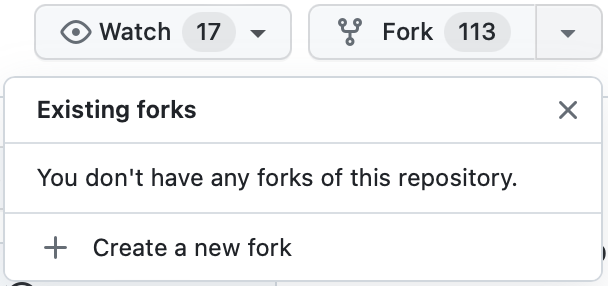
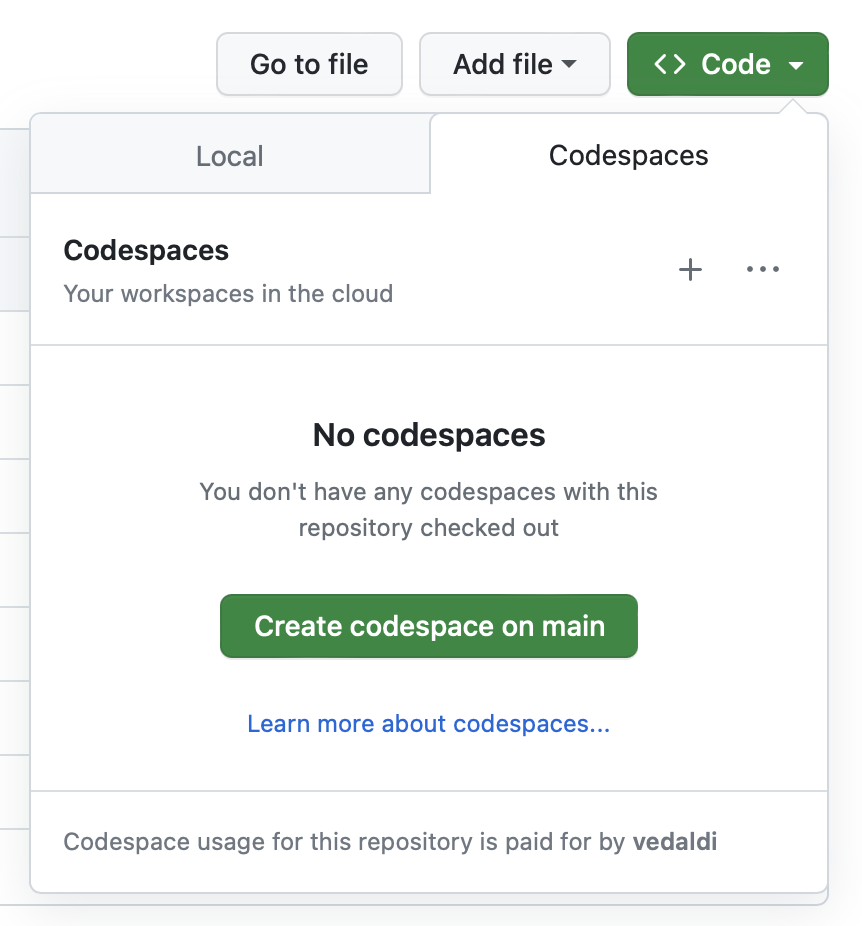
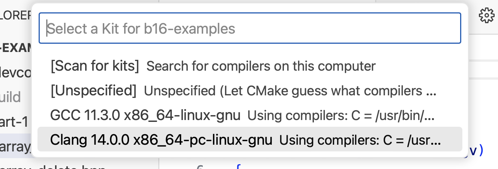
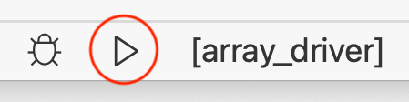
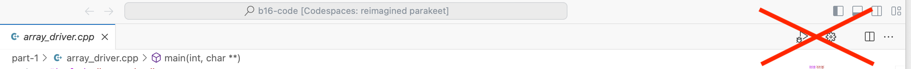
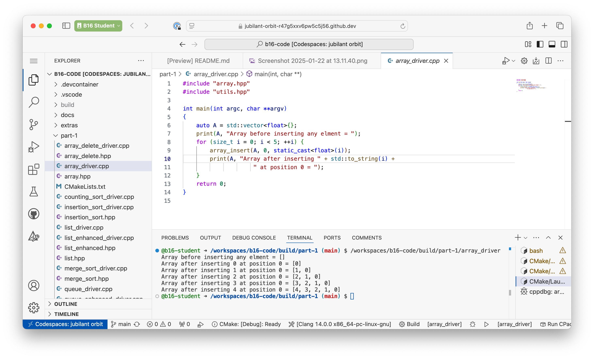
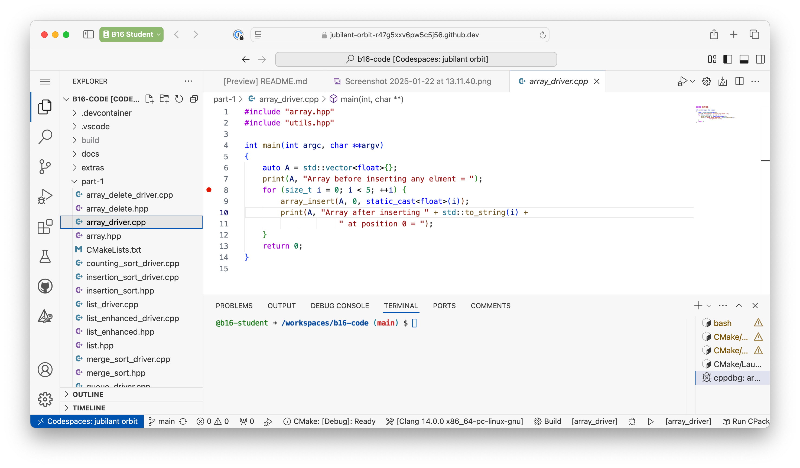
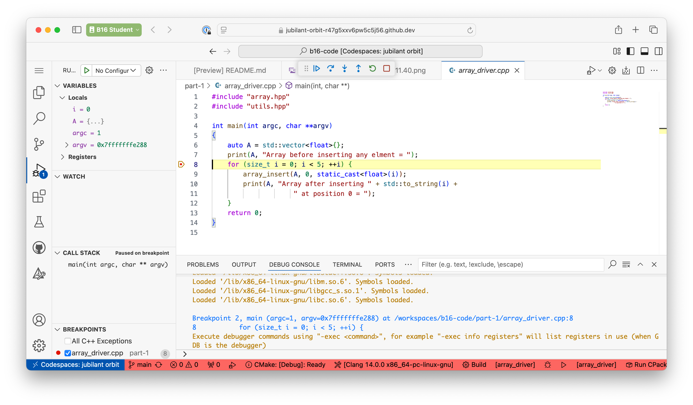
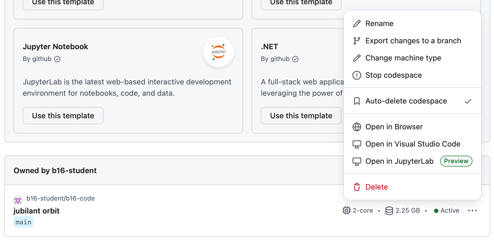
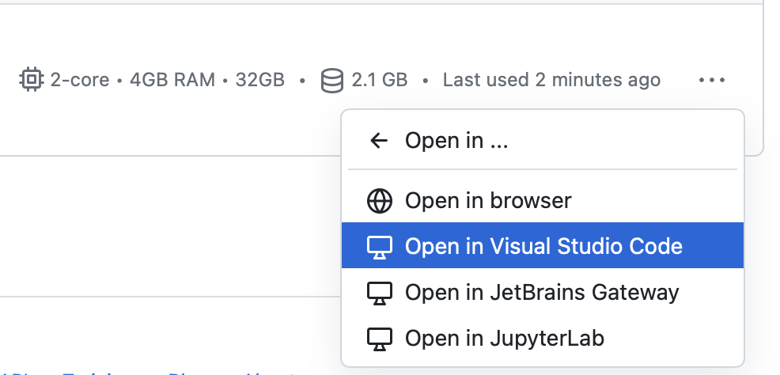

<!-- markdownlint-disable MD033 -->

# B16 Algorithms

This is the source code for the _B16 Software Engineering - Part 3: Algorithms and Data Structures_ course taught at the Engineering Science Department at the University of Oxford. The [course materials page](https://www.robots.ox.ac.uk/~vedaldi/teach.html) contains the related teaching material.

The package includes both the code for the examples (tutorial sheet) in the directory `examples` and code for all the other examples given in the notes in the directory `notes`. The code in `examples` is self-contained -- you are welcome to consult and study the code in `notes` if you wish to do so, but this is not necessary to carry out the work in the tutorial sheet.

This page explains how to set up the project code for development. You have two options:

1. Using a [codespace](#develop-using-github-codespaces) (recommended)
2. Using a [local copy](#develop-using-your-local-machine) of the code

## Develop using GitHub codespaces

The easiest way to compile the course code, as well as to do your programming exercises, is to use a [GitHub codespace](https://github.com/features/codespaces). A codespace gives you access to an online computer, already configured with a fully-featured C++ system and the project source code pre-installed and ready to compile.

To access a codespace, follow these steps:

1. You will need a GitHub account. If you do not have one, [create a GitHub account](https://github.com). After setting up your account, you can also optionally [join GitHub Education](https://education.github.com/pack/join). The latter gives you more hours per month to use codespaces.

2. Go to the [course GitHub repository](https://github.com/vedaldi/b16-code).

3. Fork the repository using the "Fork" dropdown menu and selecting "Create a new fork":

   

   This will create your own copy of the project repository. Using a fork will allow you to push your changes (save your work) as you progress, as well as to use a codespace to work on your exercises online.

4. From the forked repository, click the green "Code" button. It will open a dropdown menu. In the dropdown menu, click the "Create codespace on main" button.

   

   This will open an editor in your web browser with the project source code. This is an instance of [Visual Studio Code](https://code.visualstudio.com) (VS Code), a fully featured editor great for programming (do not confuse it with Visual Studio, an entirely different Microsoft product).

5. After a few seconds, VS Code will ask you to select a "Kit", i.e., a compiler to use for the project:

   

   We suggest picking Clang because it provides better error reporting.

6. Compile and run one of the examples:

   - First, click on the name of the target in the status bar at the bottom close to the play icon (⏵). Select a target like `array_driver` as shown below (the image might look slightly different depending on the version of VS Code).

   
     →
   

     > **Remark.** If you fail to select a specific target, the tool will compile _all_ available programs, including the ones from the example sheet. Because the programs from the example sheet are incomplete on purpose, you will get several compilation errors. This is expected.

   - Then, click on the play icon (⏵). VS Code will ask you to select a target
     for execution. Choose `array_driver` again.

   

     > **Remark.** Do _not_ use the play button at the top-right. This does not use CMake to compile your program and will generally not have the correct compilation flags.
   > 

     This will open a terminal window to show you the results:

   

7. Try to debug the example. Select `array_driver.cpp` in the file browser and click to the left of a line number to drop a breakpoint, denoted by a red bullet:

   

   Press the debug icon (it looks like a bug) next to the play icon.

   

   The debugger allows you to execute the program line-by-line while inspecting the value of the variables.

Once a codespace instance is started, it will keep running until you stop it, or automatically after 30 minutes (this timeout can be configured). Do not forget to stop your instance, as you only have 60 hours of codespace usage per month (90 if you enrol as a student).

To check which codespace instances are active and start and stop them, use the [codespace manager](https://github.com/codespaces/).



Codespaces work very well with VS Code in the browser. If you have VS Code installed on your machine, you can also start the codespace and connect to it using your local VS Code copy, which makes the experience nearly indistinguishable from using a compiler on your own machine. For this, go to the codespace manager and select "Open in Visual Studio Code":



> **Important: Deleting a codespace.** Codespaces are automatically deleted if you do not use them for more than 30 days. When you delete a codespace, automatically or manually, the virtual machine is erased, deleting all the work you have done within it. The easiest way to **save your work** is to commit your changes and push them to your GitHub clone. You can do all this within VS Code, using its integrated Git support.

## Develop using your local machine

You can also compile and run the code on your local machine. For this, download a copy of the code from the GitHub course page. To do so, use the green Code button, then select "Local" and "Download ZIP". Even better, use command-line [Git](https://git-scm.com) or the [GitHub app](https://desktop.github.com) to clone the repository to your local machine.

You will also require suitable software to compile the C++ code:

- We recommend using [VS Code](https://code.visualstudio.com) (available for Mac, Linux and Windows) to edit, compile and debug the project code. This gives you the same features as the web-based solution described above. Within VS Code, install the VS Code [C++ extension pack](https://marketplace.visualstudio.com/items?itemName=ms-vscode.cpptools-extension-pack), which adds C++ support.

- You will also need a C++ compiler. Depending on your machine, you can use:

  - Mac: Xcode, downloaded from the App Store.
  - Windows: Visual Studio Community, available from [visualstudio.microsoft.com/vs/community/](https://visualstudio.microsoft.com/vs/community/).
  - Linux: GCC, installed using your package manager.

  Note that Xcode and Visual Studio are fully-featured integrated development environments (IDE) in their own right. While they can compile and debug the project code just fine, we still recommend using VS Code for simplicity.

- You will also need [CMake](https://cmake.org), a tool for configuring software projects. You can [download CMake here](https://cmake.org/download/).

### Building using Visual Studio (Windows)

Visual Studio has native support for CMake-based projects. Follow the [official CMake project instructions for Visual Studio](https://learn.microsoft.com/en-us/cpp/build/cmake-projects-in-visual-studio).

### Building from the command line using cmake (Linux and Mac)

You can use the command line (the terminal) to compile the provided C++ programs. To do so, run `cmake` to configure the project, as follows:

```bash
cmake -B build -S .
```

This step is only needed once, or whenever you want to reconfigure the project. Next, you can use `cmake` again to compile one of the targets defined in the project. For example:

```bash
cmake --build build --target array_driver
```

Once this is done, you can run the program (the exact path depends on the specific target):

```bash
./build/examples/part-1/array_driver
```

The targets are defined in the various `CMakeLists.txt` files found in the subdirectories of `examples` (e.g., `examples/part-1/CMakeLists.txt`). As noted above, most of these targets correspond to incomplete programs, since your goal is to complete them. If you try to compile them, they will fail with an error, but `array_driver` should work out of the box.

#### Optional: building the examples in the notes

By default, the targets that correspond to the many examples given in the notes, and defined in the subdirectory `notes`, are disabled and will not compile. You can use the `-DBUILD_NOTES=ON` option to enable them. For example:

```bash
cmake -B build -S . -DBUILD_NOTES=ON
cmake --build build --target radix_sort_driver
./build/notes/part-1/radix_sort_driver
```

### Building using Xcode (Mac)

You can also use `cmake` to generate project files that you can open in Xcode on Mac and Visual Studio on Windows:

```bash
cmake -G Xcode -B build -S .
```

This will create an Xcode project in the `build/` folder, which you can open with Xcode.
